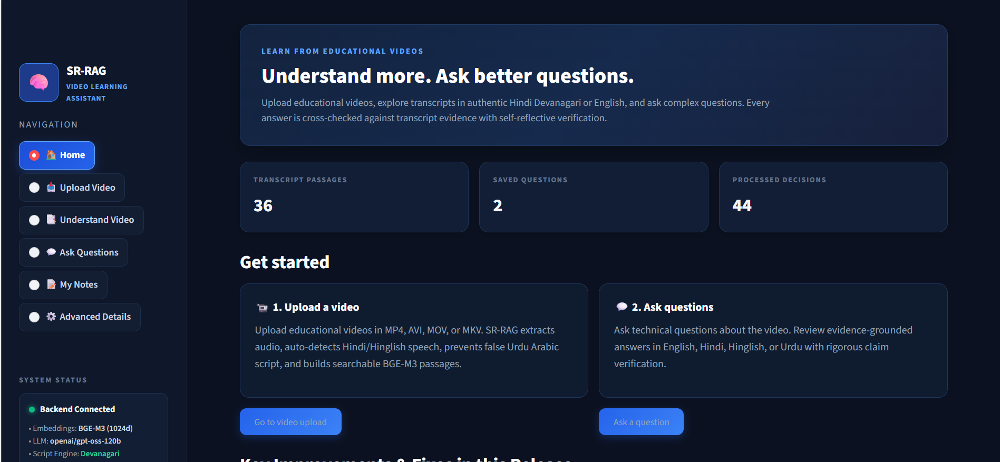
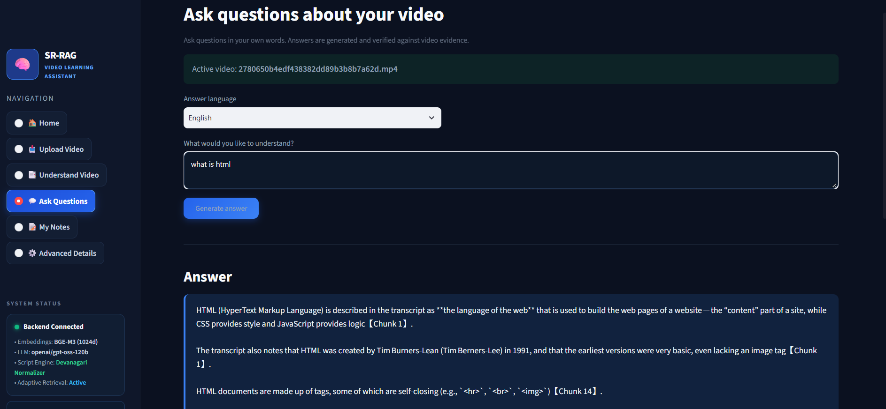
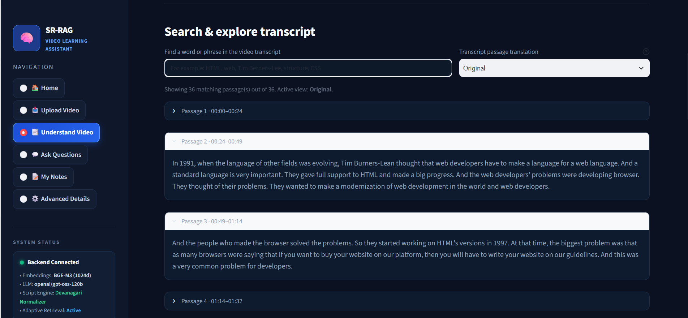

# SR-RAG: Self-Reflective Retrieval-Augmented Generation

### AI-Powered Video Learning Assistant with Hallucination Detection and Adaptive Retrieval

## Overview

SR-RAG is an AI-powered video learning assistant that helps users understand educational videos by generating summaries and answering questions based on video transcript evidence.

The application combines Retrieval-Augmented Generation (RAG), semantic search, self-reflection, and evidence verification to improve the reliability of AI-generated responses.

Unlike conventional LLM-based question-answering systems, SR-RAG evaluates whether retrieved video transcript passages provide sufficient support before presenting an answer. When evidence is insufficient, the system can abstain rather than generate an unsupported response.

## Application Dashboard



## Ask Question



## Understand Video



## Key Features

- **Video Processing:** Extracts audio from uploaded videos using FFmpeg.
- **Speech Recognition:** Converts speech into text using OpenAI Whisper.
- **Multilingual Support:** Handles English, Hindi, and Urdu language content.
- **Transcript Processing:** Organizes transcripts into smaller contextual chunks.
- **Semantic Retrieval:** Uses BAAI/bge-m3 embeddings and cosine similarity.
- **Adaptive Retrieval:** Retrieves relevant passages and expands context when required.
- **AI Question Answering:** Generates answers using Groq API.
- **Self-Reflection:** Evaluates generated responses.
- **Hallucination Detection:** Checks whether answers are supported by retrieved transcript evidence.
- **Evidence-Based Abstention:** Avoids answering when relevant evidence is insufficient.
- **Video Summarization:** Generates video overviews, key takeaways, and covered topics.
- **Evidence Display:** Shows retrieved passages with timestamps and similarity scores.
- **Translation Options:** Supports different language options for transcript evidence.
- **My Notes:** Allows users to save useful generated answers.
- **Decision Trace:** Maintains records of system decisions for inspection.

## Technology Stack

| Category | Technology |
|---|---|
| Programming Language | Python |
| User Interface | Streamlit |
| LLM API | Groq |
| Language Model | openai/gpt-oss-120b |
| Embedding Model | BAAI/bge-m3 |
| Speech Recognition | OpenAI Whisper |
| Similarity Search | NumPy, Cosine Similarity |
| Audio Processing | FFmpeg |
| Data Storage | Pickle, NumPy, JSON |

## System Workflow

1. **Video Upload:** The user uploads an educational video.
2. **Audio Extraction:** FFmpeg extracts and converts the audio.
3. **Transcription:** Whisper generates the video transcript.
4. **Transcript Processing:** The transcript is normalized and divided into contextual chunks.
5. **Embedding Generation:** BAAI/bge-m3 converts transcript chunks into vector embeddings.
6. **Knowledge Base Creation:** Transcript chunks and embeddings are stored for retrieval.
7. **Question Retrieval:** The user's question is embedded and compared against stored transcript embeddings using cosine similarity.
8. **Adaptive Retrieval:** Relevant chunks and neighboring context are retrieved.
9. **Evidence Assessment:** The system evaluates whether retrieved passages contain sufficient information.
10. **Answer Generation:** Groq generates a response using retrieved transcript evidence.
11. **Self-Reflection and Verification:** The generated answer is evaluated for evidence support and possible hallucinations.
12. **Final Decision:** The application presents the answer, requests review, or abstains when evidence is insufficient.

## Application Pages

| Page | Description |
|---|---|
| Home | Application introduction and overview |
| Upload Video | Upload and process video content |
| Understand Video | Generate summaries and identify key topics |
| Ask Questions | Ask questions about processed videos |
| My Notes | Save and revisit generated answers |
| Advanced Details | Inspect additional system information |

## Verification and Final Decisions

SR-RAG separates answer verification from the final system decision.

**Answer verification statuses:**
- Supported
- Partially Supported
- Not Verified
- Abstained

**Final decisions:**
- ANSWERED
- NEEDS_REVIEW
- ABSTAINED

For example, if a user uploads an HTML lecture and asks about database indexing, the system can identify that the transcript does not contain sufficient evidence and abstain from answering.

This approach aims to reduce unsupported responses and make the relationship between generated answers and source evidence more transparent.

## Project Configuration

Current backend configuration:

| Parameter | Value |
|---|---:|
| Segments per chunk | 5 |
| Initial Top-K | 3 |
| Expanded Top-K | 6 |
| Evidence threshold | 0.35 |
| Neighbor window | 1 |
| Embedding dimension | 1024 |

## Project Structure

```text
SR-RAG-Video-Learning-Assistant/
│
├── app.py
├── sr_rag_backend.py
├── requirements.txt
├── README.md
├── .gitignore
├── .env.example
│
└── SR_RAG_Implementation.ipynb  (optional)
```

Runtime-generated folders and files are created during application execution and are not required to be uploaded to GitHub.

## Installation and Setup

### 1. Clone the Repository

```bash
git clone https://github.com/YOUR_USERNAME/SR-RAG-Video-Learning-Assistant.git

cd SR-RAG-Video-Learning-Assistant
```

### 2. Create a Virtual Environment

```bash
python -m venv venv
```

Activate on Windows:

```bash
venv\Scripts\activate
```

### 3. Install Dependencies

```bash
pip install -r requirements.txt
```

### 4. Install FFmpeg

Download FFmpeg:

https://ffmpeg.org/download.html

Add its `bin` directory to your system PATH.

Verify installation:

```bash
ffmpeg -version
```

### 5. Configure the API Key

Create a `.env` file in the project root.

Add:

```env
GROQ_API_KEY=your_groq_api_key_here
```

Get your API key from:

https://console.groq.com/keys

Never upload your actual `.env` file or API key to GitHub.

### 6. Run the Application

```bash
streamlit run app.py
```

The application will open in your browser.

## Limitations

- Answer quality depends on the accuracy of speech recognition and transcript extraction.
- Responses are limited by the information available in the processed video.
- LLM-based verification is not a guarantee of factual correctness.
- Processing time depends on video length, model loading, and API response time.
- Groq API availability and rate limits can affect performance.

## Future Improvements

- More detailed claim-level evidence verification.
- Improved retrieval relevance evaluation.
- Better handling of mixed-language transcripts.
- More efficient video processing and caching.
- Persistent user-specific notes and learning history.
- Expanded evaluation across different video topics.

## Research Background

SR-RAG is a personal implementation and demonstration based on concepts explored in an academic research report concerning self-reflective Retrieval-Augmented Generation, hallucination detection, and adaptive retrieval.

The application brings these concepts into an interactive video-learning assistant with a Streamlit interface.

**Project:** SR-RAG – Video Learning Assistant

---

*Making video-based learning more interactive, transparent, and reliable through evidence-grounded AI question answering.*
